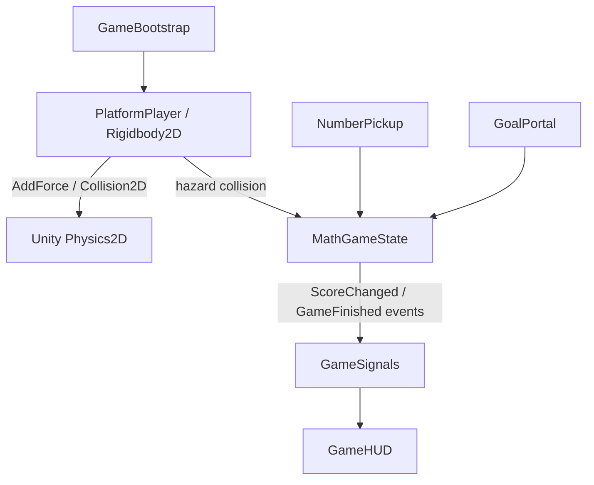

# MathKingdom-Assignment5

## How to run
1. Open the folder as a Unity 6 project (recommended 6000.0.38f1). Wait for package and script import.
2. The editor creates `Assets/Scenes/Main.unity` automatically; if missing choose **Assignment > Generate Main Scene**.
3. Open the scene and press **Play**. Move using A/D or left/right arrows; jump with Space or Up. Collect yellow 2, 3 and 5, then reach the green portal with sum 10. Falling into the red hazard or running out of time loses. R restarts.
4. Install the WebGL module, switch the build target to WebGL, choose **Assignment > Build WebGL**, then zip and upload the WebGL build files to itch.io.

## Class relationships

## Architecture decisions
- UI reacts to `GameSignals` events instead of being called by game rules; subscriptions are paired in `OnEnable`/`OnDisable`.
- `PlatformPlayer` only handles movement and collision, while `MathGameState` handles rules and win/loss; this keeps changes localized.
- `[SerializeField]` exposes speed, jump impulse, target sum, time limit and color tuning to the Inspector.

## Extending the game
- New collectible: add `NumberPickup` to a new object and set its value; adjust `MathGameState.targetSum` if the puzzle changes.
- New enemy: add an enemy script under `Assets/Scripts/Enemies` and have its collision call a game-rule method; no HUD changes are needed.
- Static use: `GameSignals` is a static event channel and `MathGameState` uses a scene-scoped static reference to simplify prototype trigger callbacks. For a multi-scene production game, replace these with injected references or ScriptableObject event channels.
- We added a Live Ops feature to Math Kingdom that allows the player’s movement speed to be adjusted while the game is running. Using the Faster (+) and Slower (-) buttons, we can increase or decrease the character’s speed without restarting the game. This makes the gameplay more flexible and demonstrates how game settings can be changed in real time to improve the player experience.

## Physics coverage
`Rigidbody2D`, `AddForce`, `Collision2D` are demonstrated; the companion Code Escape project covers `CharacterController` and `Raycast`.

## Story mode assessment 

The story mode in Math Kingdom was enjoyable and engaging. I liked how the story allowed me to make different choices that influenced what happened next, making the experience feel more interactive. The mathematical challenges fit well with the kingdom’s storyline and made the game more interesting. The different paths encouraged me to explore other possibilities and replay the story to discover alternative endings. Overall, the story was easy to follow, the choices were meaningful, and the experience was fun and satisfying.

## Links 
Link to Twine story on itch - https://yvvvvvv.itch.io/math-kingdom-the-number-gate

