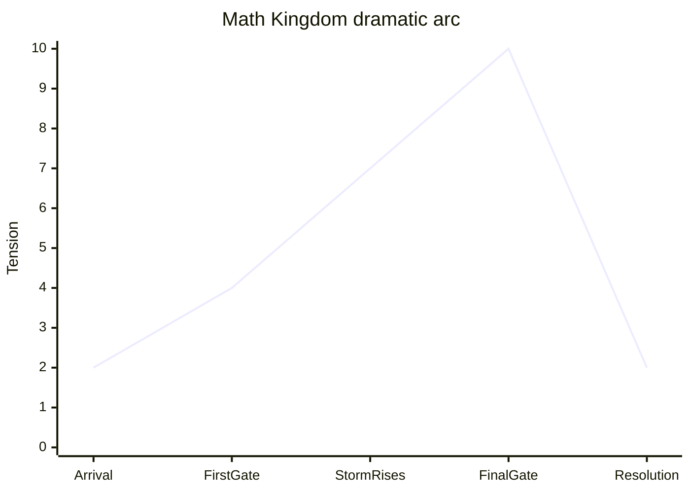

# Math Kingdom — Dramatic Elements

**Selected game:** Math Kingdom  
**Genre:** 2D platforming and arithmetic puzzle  
**Audience:** Players who enjoy short, accessible platforming challenges with a clear mathematical goal  
**Current playable prototype:** One level, three number pickups (2, 3, 5), target sum 10, 90-second timer, and a goal portal.

This document distinguishes the **current implementation** from **planned extensions**. The existing prototype is the starting point for the next development stage.

## 1. Challenge (אתגר)

The player's challenge is to traverse platforms, time jumps, collect number pickups, and reach the portal with exactly the target sum before time runs out. Failure can result from falling into the hazard, running out of time, or entering the portal with the wrong total.

**Current challenge:** The single prototype level uses numbers 2, 3 and 5, target sum 10, and a 90-second timer. The player must manage movement, jumping, and collection order.

**Three selectable difficulty presets (planned implementation):** A menu saves `DifficultyPreset` before loading a level. The level generator applies these values to actual game objects and `MathGameState`:

| Parameter / object | Easy | Medium | Hard |
|---|---|---|---|
| `MathGameState.timeLimit` | 120 s | 90 s | 60 s |
| Platform widths (`Transform.localScale.x`) | 4.0 | 3.0 | 2.2 |
| Gap widths between platforms | 1.0 units | 1.8 units | 2.5 units |
| Collectible set / target | 2, 3, 5 / 10 | 2, 3, 5, 7 / 10 | 2, 3, 5, 7, 8 / 10 |
| Hazard objects | Static floor only | One moving hazard | Two moving hazards |
| Hint display | Correct sum highlighted | Target shown only | Target shown, no pickup hints |

The Medium solution is 2+3+5; the Hard solution is 2+8 or 3+7. Both require deliberately ignoring distractor pickups. All presets must be playtested for reachability; they are **design specifications**, not features already in the prototype.

**Adaptive difficulty (planned):** Record the last five attempts as `AttemptResult` with completion, elapsed time, falls, and incorrect-sum portal entries. After each attempt compute `skillScore = 0.5 × completionRate + 0.3 × averageRemainingTimeFraction + 0.2 × (1 − min(1, averageFalls/3))`, with each term between 0 and 1. A score above 0.8 for three consecutive attempts advances one preset; below 0.35 for three consecutive attempts lowers one preset; otherwise keep it unchanged. Only change the next level, never during a jump, and show a notification plus manual override. The system modifies platform prefabs, time limits, hazards, and pickup sets, not merely the speed of the player.

Difficulty will increase gradually: first movement, then collecting, then choosing the right arithmetic combination under time pressure. To avoid unfair difficulty, each level should be tested to ensure at least one achievable route and solution.

## 2. Flow (זרימה)

The game aims to keep the player between boredom and frustration. Controls are simple, the objective is visible, and each collected number produces immediate score feedback. Short levels and quick restarts encourage experimentation.

The intended flow cycle is: observe the target → plan a route → execute jumps → collect numbers → compare the sum → reach the portal → receive clear success/failure feedback. The timer adds urgency without making the first level excessively demanding.

A player should feel progress from learning a jump, collecting a number, and seeing the score update. Failure should explain what happened (wrong sum, hazard, or time), allowing the player to adapt on the next attempt.

## 3. Amusement (שעשוע)

Beyond the central mathematical objective, the platforming itself can be enjoyable: experimenting with jumps, finding alternate routes, and trying to finish with time to spare.

**Currently available:** Free movement, jumping, and replaying the level.  
**Planned optional amusements:** Hidden decorative number symbols, a harmless bouncing platform, and a nonessential scenic route. These should never obstruct the main objective or make the arithmetic requirement unclear.

**Player types and corresponding features:** Achievers can earn optional three-star scores for finishing under 40 seconds, collecting the correct subset, and avoiding falls; Explorers can discover a hidden alcove behind Platform 2 and collect lore fragments; Story-oriented players can talk to the Gatekeeper before each gate and unlock short dialogue; Experimenters can try alternate jump routes and number combinations; Speedrunners can replay with a best-time display. None of these optional features should block a casual player. To broaden the audience, include a no-timer practice mode, readable UI and color-independent pickup labels, and optional hints. Each reward should have a concrete trigger and stored flag (`starsEarned`, `loreFound`, `bestTime`) in a future save system.

## 4. Emotions (רגשות)

The design aims to evoke **curiosity** when players first see the level, **concentration** during platform jumps, **tension** as time runs low, **satisfaction** when the sum reaches the target, and **relief/pride** upon reaching the portal.

Bright, distinct colors communicate object roles: yellow numbers are collectibles, green marks the goal, and red marks danger. Immediate messages after success or failure help make outcomes understandable rather than arbitrary.

## 5. Backstory (סיפור־רקע)

The Math Kingdom's ancient Number Gates once kept its regions connected. A magical disturbance scattered the numbers needed to open the gates. The player is a young courier tasked with recovering the correct numerical combinations to restore the kingdom's paths.

The prototype does not currently display this story in Unity. It is presented as a **planned narrative framing** and in the accompanying interactive Twine introduction (`math-kingdom-story.html`). The story should be optional and short so it does not interrupt repeated attempts.

## 6. Characters (דמויות)

**The Courier (player):** Curious, determined, and resourceful. The player controls movement and decides how to approach platforms and pickups.

**The Gatekeeper (planned supporting character):** A guardian who explains why each Number Gate needs a particular sum. The Gatekeeper provides hints but does not solve the level for the player.

**The Number Storm (environmental antagonist):** A magical disruption rather than a speaking villain. It creates the game's conflict by scattering numbers and destabilizing paths.

**Development through play (planned):** The Courier begins as an inexperienced messenger; after clearing the first gate, the Gatekeeper trusts them with a map, and after the final gate the Courier becomes a recognized path-restorer. The Gatekeeper changes dialogue based on gates opened (`gatesCleared`), from instructional to respectful. The Number Storm grows more unstable in later regions, reflected in hazard frequency and environmental effects.

**Free-will-like behavior (planned, not real AI):** The Gatekeeper uses a finite-state machine (`Idle`, `Greeting`, `Hint`, `Celebration`) with transitions triggered by player proximity, wrong-sum attempts, and successful gates. To avoid repeating itself, it chooses between two context-appropriate hint lines using a seeded random index and remembers the last hint. Ambient number spirits choose between `Wander`, `AvoidPlayer`, and `Rest` based on distance thresholds. Their bounded choices create an impression of independent action while remaining deterministic and testable.

The current Unity prototype represents the player as a simple colored shape and does not include dialogue or NPCs. Characters are narrative concepts to develop in later versions.

## 7. Plot (עלילה)

**Central conflict:** The kingdom's gates are sealed because their numerical seals are broken. The Courier must gather numbers that add up to the required total while overcoming environmental obstacles.

**Dramatic arc (tension versus story progress; design target):**

The same curve in plain text for Markdown viewers without Mermaid support: Arrival (2/10) → First Gate (4/10) → Storm Rises (7/10) → Final Gate (10/10) → Resolution (2/10). The rise corresponds to tighter time limits and more distracting numbers; the peak is the final timed gate; the resolution follows successful restoration.

**Beginning:** The Gatekeeper explains the first sealed gate and the sum of 10.  
**Development:** The player learns how numbers and movement work together; future gates require harder decisions.  
**Climax:** The Courier chooses the correct combination and reaches the final gate before the Number Storm closes the path.  
**Resolution:** The gate opens and the route is restored, setting up further regions.

**Branching and player influence (planned game integration):** At the opening the Courier can ask the Gatekeeper about the storm (learn a hint) or accept the challenge immediately (skip exposition). Choosing a cautious route offers safer jumps but less spare time; choosing a risky route offers a faster finish with greater fall risk. Correct number subsets open the gate; a wrong sum produces a retry and a contextual Gatekeeper hint. The Twine story models narrative choices; Unity currently implements the numeric success/failure condition, not the full story branches.

The interactive introduction is provided in `math-kingdom-story.html` and the editable Twine source in `math-kingdom-story.twee`. It offers short choices, multiple responses, and a route to the game objective. The Twine story is narrative material; it is not yet integrated into the Unity game.

## 8. World Building (בניית עולם)

The Math Kingdom is a whimsical realm of floating stone platforms, number shrines, and gates activated by arithmetic. Its geography consists of connected regions, each associated with a different numerical challenge. The Number Storm has broken the routes between them.

**Natural laws:** Gravity and jumping behave like familiar 2D platform physics, but Number Gates open only when collected values exactly match the gate target; excess numbers do not count as a success. **Geography:** Addition Valley contains beginner floating platforms, Subtraction Bridge has longer gaps, and Multiplication Tower introduces moving hazards. **History:** The gates were built to connect settlements; the Number Storm shattered their seals shortly before the story. **Economy:** Couriers deliver supplies across gate routes, so closed gates disrupt trade; reopening a gate restores access to a settlement. **Society:** Gatekeepers teach arithmetic to apprentices and maintain public gate records. **Politics:** A council of regional Gatekeepers allocates repair priorities, creating a nonviolent conflict between restoring the trade route first or helping an isolated village.

**How the player learns:** The first gate teaches the numerical rule through an interactive target and three pickups; signposts introduce region names; optional NPC dialogue explains trade and history; reopening a gate visually reconnects a path on the world map. The full setting is planned, not implemented in the single-level Unity prototype.

**Current representation:** A single abstract platform level.  
**Planned expansion:** Distinct themed regions (addition valley, subtraction bridge, multiplication tower) with recognizable environments and progressively more complex goals.

## 9. Meta-game (מטא־משחק)

The current prototype has no persistent progression, shop, multiplayer system, or achievements. The player can replay the level and try to finish more efficiently.

**Best-fitting meta-game types:** (1) **Progression/unlocking**: completing Gate 1 unlocks Addition Valley's next gate; (2) **Achievement/mastery**: award one star for finishing, a second for no falls, and a third for finishing with at least 30 seconds left; (3) **Collection**: record discovered lore fragments and gate solutions in a journal; (4) **Replay/optimization**: save a best completion time per gate. Persist these values by gate ID using a versioned local save record and show them on the level-selection map. No multiplayer, competitive leaderboard, or shop is needed for the intended small-scale game.

Potential future meta-game features include a level-selection map, stars for completing a level quickly, optional challenges, and a collection journal showing previously solved gate sums. These would reward replay without being required to complete the core game.

## 10. Live Ops / Dynamic Configuration (ניהול חי)

**Implemented live event:** "Courier Speed Weekend" changes the player's movement speed without restarting or recompiling. The existing Faster (+) and Slower (-) buttons remain available, and a **Reload Config** button loads an external JSON configuration while the game is running.

**Configuration source:** `Assets/StreamingAssets/liveops.json`, copied into the build's `StreamingAssets` directory. It contains `{ "moveSpeed": 6.0, "eventName": "Courier Speed Weekend" }`. `LiveOpsSpeedControl` requests the file with `UnityWebRequest` using `Application.streamingAssetsPath`, which supports WebGL URLs as well as desktop file paths. The response is parsed with `JsonUtility.FromJson<LiveOpsConfig>`, validated (`2 <= moveSpeed <= 12`), and applied through `PlatformPlayer.SetMoveSpeed`. If loading fails, the current speed remains unchanged and the panel displays an error.

**Demonstration in Unity Editor or a desktop build:**
1. Open the generated main scene and press Play. Observe the Live Ops panel and initial speed 6.
2. Edit `Assets/StreamingAssets/liveops.json` to set `moveSpeed` to 9 while Play mode is running, and save it.
3. Click **Reload Config**. The panel should show speed 9 and movement should visibly accelerate.
4. Set the JSON speed to 4, save, and reload. The character should move more slowly.
5. Click Faster (+) or Slower (-) to demonstrate local manual overrides; click Reload Config to restore the file-controlled value.

**WebGL note:** After building, the `StreamingAssets/liveops.json` URL must be served by the web host. To run a live event after publishing, update the hosted JSON file at that URL and click Reload Config; merely editing the Unity source file does not change an already-uploaded WebGL build. Host caching may require cache-control configuration. This is **file/URL-based dynamic loading**, not an admin dashboard or automated remote event scheduler.

**Safety and design:** Only approved numeric fields are accepted, invalid JSON does not crash the game, and movement speed is clamped to 2–12. The event can make the existing level easier or harder without changing game rules. This fulfills the requested example of loading configuration dynamically and applying it during gameplay.
